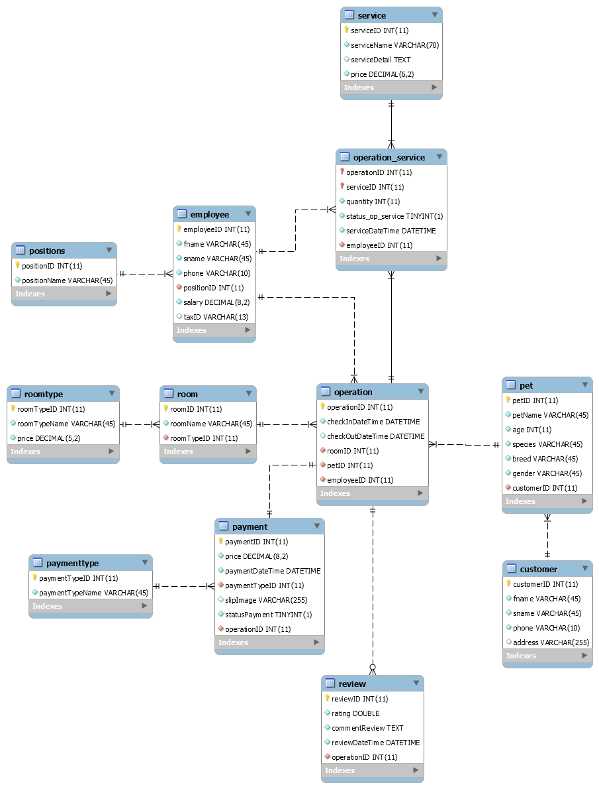

# Pet-Dailycare
A relational database management system for a Pet Hotel , developed as a 2nd-year university project. Features complete ER/EER diagrams, 3NF normalization, and advanced SQL queries for pet boarding, room reservations, and service management.
 
